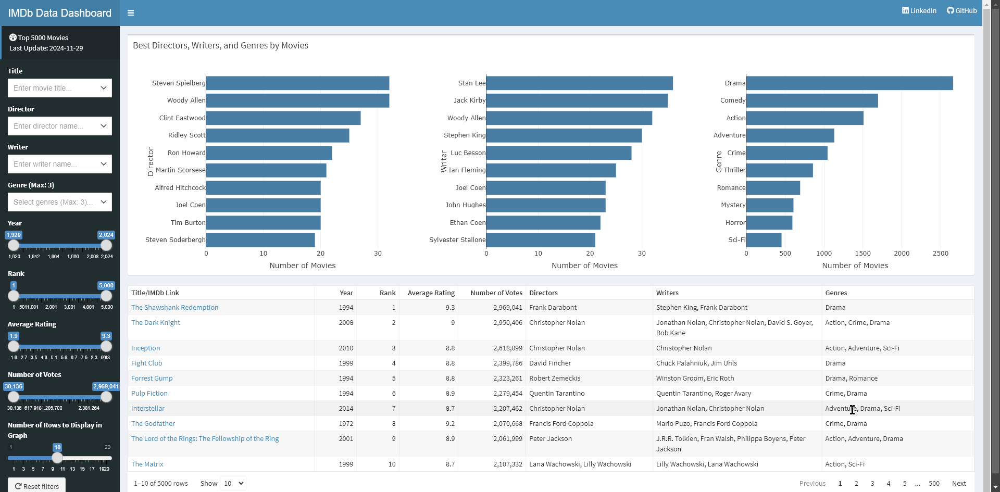
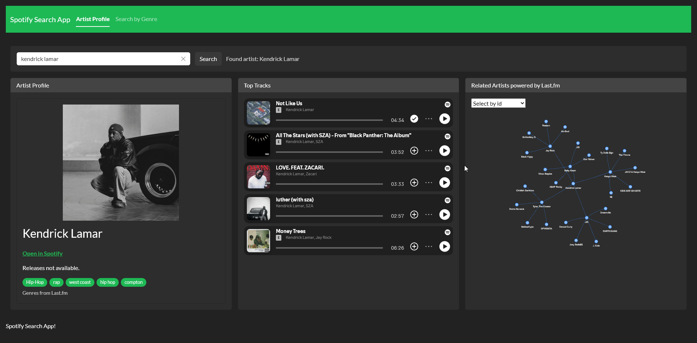
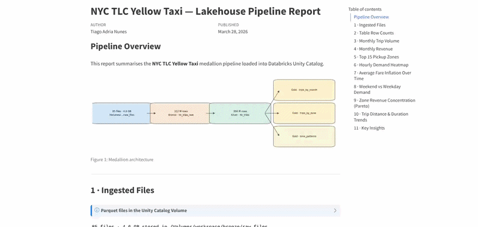

# Tiago Adria Nunes

R/Shiny Developer and Analytics Engineer

# Tiago Adria Nunes

I build production R/Shiny applications that turn complex data into decisions people actually use.

I develop and maintain analytical web applications for the Data Science team at **Firebird Music**, backed by about 10 years as an IT Business Analyst and Systems Analyst across **banking**, **healthcare**, **insurance**, **education**, and **investments**.

[View projects ](#projects) [ Email me](mailto:tiagoadrianunes@gmail.com)  

10+ years in IT 5 industries 6 featured projects

## About

I’m an R/Shiny Developer at **Firebird Music**, where I develop and maintain analytical web applications for the Data Science team. My work covers the full path from data to user: modular Shiny apps built on Rhino and box, data from BigQuery and PostgreSQL, dbt and Airflow workflows, DuckDB for fast processing, automated tests with testthat, and Docker-based CI/CD deployments.

Before moving into development, I spent about 10 years as an IT Business Analyst and Systems Analyst across banking (Bradesco, Caixa Econômica Federal), healthcare (Unimed), insurance, education, and investments. That background is my edge: I understand business rules, work well with stakeholders, and translate requirements into data products that fit how people actually work.

I’m interested in building scalable, maintainable data applications and analytics platforms that combine software engineering practices with modern data tooling.

###  Career path

- Now R/Shiny Developer Firebird Music · Data Science team
- About 10 years IT Business Analyst & Systems Analyst Bradesco, Caixa Econômica Federal, Unimed, plus insurance, education, and investments

## Projects

Shiny apps and data engineering pipelines I’ve built. Hover a card to play its demo.

### [IMDb Top 5000](https://github.com/TiagoAdriaNunes/imdb_top_5000)

R Shiny ShinyApps.io

Interactive dashboard showcasing the top 5000 movies from IMDb, sourced live from [IMDb datasets](https://datasets.imdbws.com/). Filter by title, director, genre, year, rank, rating, and vote count.

Highlights

- Filter by title, director, genre, year, rank, rating, and votes
- TV Shows edition: [IMDb Top 5000 TV Shows](https://github.com/TiagoAdriaNunes/imdb_top_5000_tv_shows) - same filtering approach applied to series and TV content

[ Code](https://github.com/TiagoAdriaNunes/imdb_top_5000) [ Live app](https://tiagoadrianunes.shinyapps.io/IMDB_TOP_5000/)

### [Last.fm Global Trends](https://github.com/TiagoAdriaNunes/lastfm-global-trends)

Python Shiny Last.fm API

Interactive dashboard connecting to the Last.fm API to explore global and country-level music trends in real time.

Highlights

- Real-time Last.fm API integration via pylast
- Global and country-level trend drill-down

[ Code](https://github.com/TiagoAdriaNunes/lastfm-global-trends) [ Live app](https://tiagoadrianunes.shinyapps.io/lastfm-global-trends/)

### [Spotify Search App](https://github.com/TiagoAdriaNunes/shiny_spotify)

R Shiny Rhino Spotify API

Search for artists, explore their profiles, top tracks, and related artists via the Spotify API. Includes genre-based discovery and network visualization of artist relationships.

Highlights

- Artist profiles with top tracks and related-artist network graph
- Genre-based discovery with popularity and follower metrics
- API caching via memoise; built with the enterprise-grade Rhino framework

[ Code](https://github.com/TiagoAdriaNunes/shiny_spotify) [ Live app](https://tiagoadrianunes.shinyapps.io/shiny_spotify/)

### [Databricks Ingestion Lakehouse](https://github.com/TiagoAdriaNunes/databricks-ingestion-lakehouse)

Python PySpark Databricks Delta Lake Docker

End-to-end data ingestion pipeline using NYC TLC Yellow Taxi data, organised into a **Bronze → Silver → Gold** medallion architecture. Runs both locally via Docker (PySpark + Delta Lake) and on Databricks (Unity Catalog + SQL Warehouse).

Highlights

- Bronze: raw Parquet ingestion into Delta tables with metadata
- Silver: cleaning, filtering, and enrichment with derived columns
- Gold: analytics-ready aggregations for trip volume, revenue, zone performance, and time patterns
- Live analytics report published via GitHub Pages

[ Code](https://github.com/TiagoAdriaNunes/databricks-ingestion-lakehouse) [ Live report](https://tiagoadrianunes.github.io/databricks-ingestion-lakehouse/)

Pipeline Airflow → dbt · Cosmos → DuckLake → Grafana

### [Airflow DBT DuckDB Pipeline](https://github.com/TiagoAdriaNunes/airflow-dbt-duckdb)

Python Airflow DBT DuckDB DuckLake Grafana Prometheus Docker

End-to-end data pipeline orchestrating dbt transformations via Astronomer Cosmos on Apache Airflow, with DuckDB + DuckLake as the analytical engine and open table format, backed by a full observability stack.

Highlights

- Daily DAG: TPC-H data generation → dbt Cosmos task group (one Airflow task per model) → staging and mart layers
- DuckLake open table format with Parquet data files and PostgreSQL catalog
- Observability: ducklake-metrics exporter → OpenTelemetry Collector → Prometheus → Grafana dashboards

[ Code](https://github.com/TiagoAdriaNunes/airflow-dbt-duckdb)

Lineage Staging → Marts → Snapshots → dbt docs

### [dbt + pg_duckdb](https://github.com/TiagoAdriaNunes/dbt_pg_duckdb)

Python DBT DuckDB PostgreSQL Docker

Dockerized PostgreSQL with the pg_duckdb extension and a dbt project for analytics transformations on TPC-H benchmark data. Every query is routed through DuckDB’s vectorized columnar engine via an `on-run-start` hook.

Highlights

- Staging → Mart → Snapshot layers with enforced model contracts and SCD2 history
- Incremental models, automated data quality tests, and lineage DAG
- Live dbt docs auto-published to GitHub Pages on every push to main

[ Code](https://github.com/TiagoAdriaNunes/dbt_pg_duckdb) [ Live docs](https://tiagoadrianunes.github.io/dbt_pg_duckdb/)

## Skills

What I do best, and the tools I use for each.

###  R/Shiny application engineering

R Shiny Rhino box shiny.telemetry Tidyverse Quarto

###  Analytics engineering

SQL BigQuery PostgreSQL dbt Airflow Data Modeling ELT/ETL Delta Lake

###  Fast data processing

DuckDB duckplyr dplyr Python PySpark SparkR

###  Interactive data visualization

echarts4r reactable ggplot2 Matplotlib Power BI Tableau

###  Testing, CI/CD & deployment

testthat Docker GitHub Actions GitLab CI/CD

###  Bridging business & tech

Requirements Gathering Business Analysis BPMN UML Scrum Kanban Jira Confluence

## Education & Certifications

###  Education

- 2023–2024 Postgraduate in Software Engineering Descomplica
- 2006–2009 B.A. in Business Administration Anhanguera

###  Certifications

- 2023 [Google Advanced Data Analytics Professional Certificate](https://www.coursera.org/professional-certificates/google-advanced-data-analytics) Coursera
- 2023 [Data Science: Foundations using R](https://www.coursera.org/specializations/data-science-foundations-r) Coursera
- 2022 [Google Data Analytics Professional Certificate](https://www.coursera.org/professional-certificates/google-data-analytics) Coursera
- 2018 [Software Product Management Specialization](https://www.coursera.org/specializations/software-product-management) Coursera

## Contact

### Let’s connect

Have a data application or analytics platform in mind, or a question about one of my projects? Send me a message.

[ tiagoadrianunes@gmail.com](mailto:tiagoadrianunes@gmail.com) [ LinkedIn](https://www.linkedin.com/in/tiagoadrianunes/) [ GitHub](https://github.com/TiagoAdriaNunes)
