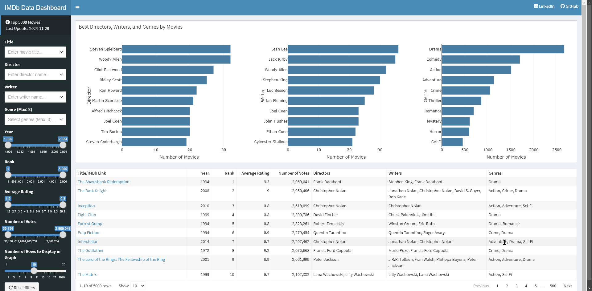
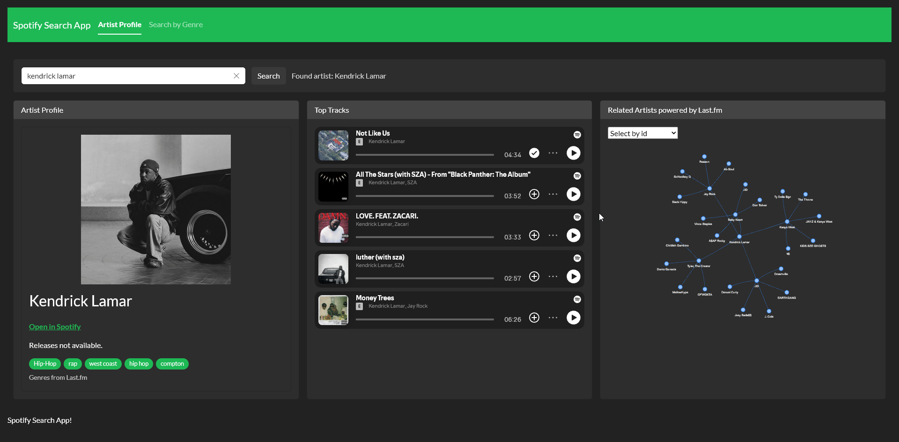
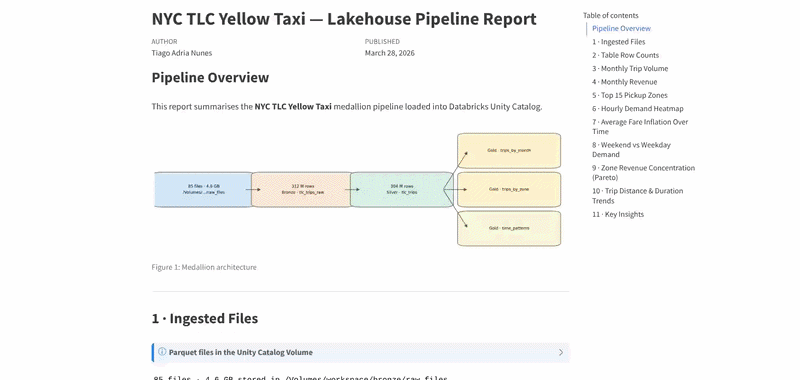

::: {.hero}
::: {.hero-copy}
[R/Shiny Developer and Analytics Engineer]{.eyebrow}

# Tiago Adria Nunes {.unlisted}

::: {.hero-tagline}
I build production [R/Shiny applications]{.gradient-text} that turn complex data into decisions people actually use.
:::

::: {.hero-intro}
I develop and maintain analytical web applications for the Data Science team at **Firebird Music**, backed by about 10 years as an IT Business Analyst and Systems Analyst across **banking**, **healthcare**, **insurance**, **education**, and **investments**.
:::

::: {.hero-actions}
[View projects <i class="bi bi-arrow-down-short"></i>](#projects){.pf-btn .pf-btn-primary} [<i class="bi bi-envelope"></i> Email me](mailto:tiagoadrianunes@gmail.com){.pf-btn} [<i class="bi bi-linkedin"></i>](https://www.linkedin.com/in/tiagoadrianunes/){.pf-btn .pf-btn-icon target="_blank" aria-label="LinkedIn"} [<i class="bi bi-github"></i>](https://github.com/TiagoAdriaNunes){.pf-btn .pf-btn-icon target="_blank" aria-label="GitHub"}
:::

::: {.hero-stats}
[[10+]{.stat-value} [years in IT]{.stat-label}]{.stat} [[5]{.stat-value} [industries]{.stat-label}]{.stat} [[6]{.stat-value} [featured projects]{.stat-label}]{.stat}
:::
:::

::: {.hero-photo}
{fig-alt="Portrait of Tiago Adria Nunes"}
:::
:::

## About {#about}

::: {.about-grid}
::: {.about-text}
I'm an R/Shiny Developer at **Firebird Music**, where I develop and maintain analytical web applications for the Data Science team. My work covers the full path from data to user: modular Shiny apps built on Rhino and box, data from BigQuery and PostgreSQL, dbt and Airflow workflows, DuckDB for fast processing, automated tests with testthat, and Docker-based CI/CD deployments.

Before moving into development, I spent about 10 years as an IT Business Analyst and Systems Analyst across banking (Bradesco, Caixa Econômica Federal), healthcare (Unimed), insurance, education, and investments. That background is my edge: I understand business rules, work well with stakeholders, and translate requirements into data products that fit how people actually work.

I'm interested in building scalable, maintainable data applications and analytics platforms that combine software engineering practices with modern data tooling.
:::

::: {.timeline-card}
### <i class="bi bi-briefcase"></i> Career path

::: {.timeline}
- [Now]{.tl-date} [R/Shiny Developer]{.tl-title} [Firebird Music · Data Science team]{.tl-org}
- [About 10 years]{.tl-date} [IT Business Analyst & Systems Analyst]{.tl-title} [Bradesco, Caixa Econômica Federal, Unimed, plus insurance, education, and investments]{.tl-org}
:::
:::
:::

## Projects {#projects}

::: {.section-lead}
Shiny apps and data engineering pipelines I've built. Hover a card to play its demo.
:::

::: {.project-grid}

::: {.project-card}
[{fig-alt="IMDb Top 5000 app demo"}](https://tiagoadrianunes.shinyapps.io/IMDB_TOP_5000/){.project-media target="_blank" aria-label="Open the IMDb Top 5000 live app"}

### [IMDb Top 5000](https://github.com/TiagoAdriaNunes/imdb_top_5000){target="_blank"}

::: {.chips}
[R]{.chip} [Shiny]{.chip} [ShinyApps.io]{.chip}
:::

Interactive dashboard showcasing the top 5000 movies from IMDb, sourced live from [IMDb datasets](https://datasets.imdbws.com/){target="_blank"}. Filter by title, director, genre, year, rank, rating, and vote count.

Highlights

- Filter by title, director, genre, year, rank, rating, and votes
- TV Shows edition: [IMDb Top 5000 TV Shows](https://github.com/TiagoAdriaNunes/imdb_top_5000_tv_shows){target="_blank"} - same filtering approach applied to series and TV content

::: {.project-links}
[<i class="bi bi-github"></i> Code](https://github.com/TiagoAdriaNunes/imdb_top_5000){target="_blank"} [<i class="bi bi-box-arrow-up-right"></i> Live app](https://tiagoadrianunes.shinyapps.io/IMDB_TOP_5000/){target="_blank"}
:::
:::

::: {.project-card}
[{fig-alt="Last.fm Global Trends app demo"}](https://tiagoadrianunes.shinyapps.io/lastfm-global-trends/){.project-media target="_blank" aria-label="Open the Last.fm Global Trends live app"}

### [Last.fm Global Trends](https://github.com/TiagoAdriaNunes/lastfm-global-trends){target="_blank"}

::: {.chips}
[Python]{.chip} [Shiny]{.chip} [Last.fm API]{.chip}
:::

Interactive dashboard connecting to the Last.fm API to explore global and country-level music trends in real time.

Highlights

- Real-time Last.fm API integration via pylast
- Global and country-level trend drill-down

::: {.project-links}
[<i class="bi bi-github"></i> Code](https://github.com/TiagoAdriaNunes/lastfm-global-trends){target="_blank"} [<i class="bi bi-box-arrow-up-right"></i> Live app](https://tiagoadrianunes.shinyapps.io/lastfm-global-trends/){target="_blank"}
:::
:::

::: {.project-card}
[{fig-alt="Spotify Search App demo"}](https://tiagoadrianunes.shinyapps.io/shiny_spotify/){.project-media target="_blank" aria-label="Open the Spotify Search live app"}

### [Spotify Search App](https://github.com/TiagoAdriaNunes/shiny_spotify){target="_blank"}

::: {.chips}
[R]{.chip} [Shiny]{.chip} [Rhino]{.chip} [Spotify API]{.chip}
:::

Search for artists, explore their profiles, top tracks, and related artists via the Spotify API. Includes genre-based discovery and network visualization of artist relationships.

Highlights

- Artist profiles with top tracks and related-artist network graph
- Genre-based discovery with popularity and follower metrics
- API caching via memoise; built with the enterprise-grade Rhino framework

::: {.project-links}
[<i class="bi bi-github"></i> Code](https://github.com/TiagoAdriaNunes/shiny_spotify){target="_blank"} [<i class="bi bi-box-arrow-up-right"></i> Live app](https://tiagoadrianunes.shinyapps.io/shiny_spotify/){target="_blank"}
:::
:::

::: {.project-card}
[{fig-alt="Databricks Ingestion Lakehouse pipeline report"}](https://tiagoadrianunes.github.io/databricks-ingestion-lakehouse/){.project-media target="_blank" aria-label="Open the Databricks Ingestion Lakehouse live report"}

### [Databricks Ingestion Lakehouse](https://github.com/TiagoAdriaNunes/databricks-ingestion-lakehouse){target="_blank"}

::: {.chips}
[Python]{.chip} [PySpark]{.chip} [Databricks]{.chip} [Delta Lake]{.chip} [Docker]{.chip}
:::

End-to-end data ingestion pipeline using NYC TLC Yellow Taxi data, organised into a **Bronze → Silver → Gold** medallion architecture. Runs both locally via Docker (PySpark + Delta Lake) and on Databricks (Unity Catalog + SQL Warehouse).

Highlights

- Bronze: raw Parquet ingestion into Delta tables with metadata
- Silver: cleaning, filtering, and enrichment with derived columns
- Gold: analytics-ready aggregations for trip volume, revenue, zone performance, and time patterns
- Live analytics report published via GitHub Pages

::: {.project-links}
[<i class="bi bi-github"></i> Code](https://github.com/TiagoAdriaNunes/databricks-ingestion-lakehouse){target="_blank"} [<i class="bi bi-box-arrow-up-right"></i> Live report](https://tiagoadrianunes.github.io/databricks-ingestion-lakehouse/){target="_blank"}
:::
:::

::: {.project-card}
::: {.project-media .project-diagram aria-hidden="true"}
[Pipeline]{.diagram-label} [Airflow]{.node} [→]{.arrow} [dbt · Cosmos]{.node} [→]{.arrow} [DuckLake]{.node} [→]{.arrow} [Grafana]{.node}
:::

### [Airflow DBT DuckDB Pipeline](https://github.com/TiagoAdriaNunes/airflow-dbt-duckdb){target="_blank"}

::: {.chips}
[Python]{.chip} [Airflow]{.chip} [DBT]{.chip} [DuckDB]{.chip} [DuckLake]{.chip} [Grafana]{.chip} [Prometheus]{.chip} [Docker]{.chip}
:::

End-to-end data pipeline orchestrating dbt transformations via Astronomer Cosmos on Apache Airflow, with DuckDB + DuckLake as the analytical engine and open table format, backed by a full observability stack.

Highlights

- Daily DAG: TPC-H data generation → dbt Cosmos task group (one Airflow task per model) → staging and mart layers
- DuckLake open table format with Parquet data files and PostgreSQL catalog
- Observability: ducklake-metrics exporter → OpenTelemetry Collector → Prometheus → Grafana dashboards

::: {.project-links}
[<i class="bi bi-github"></i> Code](https://github.com/TiagoAdriaNunes/airflow-dbt-duckdb){target="_blank"}
:::
:::

::: {.project-card}
::: {.project-media .project-diagram aria-hidden="true"}
[Lineage]{.diagram-label} [Staging]{.node} [→]{.arrow} [Marts]{.node} [→]{.arrow} [Snapshots]{.node} [→]{.arrow} [dbt docs]{.node}
:::

### [dbt + pg\_duckdb](https://github.com/TiagoAdriaNunes/dbt_pg_duckdb){target="_blank"}

::: {.chips}
[Python]{.chip} [DBT]{.chip} [DuckDB]{.chip} [PostgreSQL]{.chip} [Docker]{.chip}
:::

Dockerized PostgreSQL with the pg_duckdb extension and a dbt project for analytics transformations on TPC-H benchmark data. Every query is routed through DuckDB's vectorized columnar engine via an `on-run-start` hook.

Highlights

- Staging → Mart → Snapshot layers with enforced model contracts and SCD2 history
- Incremental models, automated data quality tests, and lineage DAG
- Live dbt docs auto-published to GitHub Pages on every push to main

::: {.project-links}
[<i class="bi bi-github"></i> Code](https://github.com/TiagoAdriaNunes/dbt_pg_duckdb){target="_blank"} [<i class="bi bi-box-arrow-up-right"></i> Live docs](https://tiagoadrianunes.github.io/dbt_pg_duckdb/){target="_blank"}
:::
:::

:::

## Skills {#skills}

::: {.section-lead}
What I do best, and the tools I use for each.
:::

::: {.skills-grid}

::: {.skill-card}
### <i class="bi bi-window-stack"></i> R/Shiny application engineering

::: {.chips}
[R]{.chip} [Shiny]{.chip} [Rhino]{.chip} [box]{.chip} [shiny.telemetry]{.chip} [Tidyverse]{.chip} [Quarto]{.chip}
:::
:::

::: {.skill-card}
### <i class="bi bi-diagram-3"></i> Analytics engineering

::: {.chips}
[SQL]{.chip} [BigQuery]{.chip} [PostgreSQL]{.chip} [dbt]{.chip} [Airflow]{.chip} [Data Modeling]{.chip} [ELT/ETL]{.chip} [Delta Lake]{.chip}
:::
:::

::: {.skill-card}
### <i class="bi bi-lightning-charge"></i> Fast data processing

::: {.chips}
[DuckDB]{.chip} [duckplyr]{.chip} [dplyr]{.chip} [Python]{.chip} [PySpark]{.chip} [SparkR]{.chip}
:::
:::

::: {.skill-card}
### <i class="bi bi-bar-chart-line"></i> Interactive data visualization

::: {.chips}
[echarts4r]{.chip} [reactable]{.chip} [ggplot2]{.chip} [Matplotlib]{.chip} [Power BI]{.chip} [Tableau]{.chip}
:::
:::

::: {.skill-card}
### <i class="bi bi-shield-check"></i> Testing, CI/CD & deployment

::: {.chips}
[testthat]{.chip} [Docker]{.chip} [GitHub Actions]{.chip} [GitLab CI/CD]{.chip}
:::
:::

::: {.skill-card}
### <i class="bi bi-people"></i> Bridging business & tech

::: {.chips}
[Requirements Gathering]{.chip} [Business Analysis]{.chip} [BPMN]{.chip} [UML]{.chip} [Scrum]{.chip} [Kanban]{.chip} [Jira]{.chip} [Confluence]{.chip}
:::
:::

:::

## Education & Certifications {#education}

::: {.background-grid}

::: {.timeline-card}
### <i class="bi bi-mortarboard"></i> Education

::: {.timeline}
- [2023–2024]{.tl-date} [Postgraduate in Software Engineering]{.tl-title} [Descomplica]{.tl-org}
- [2006–2009]{.tl-date} [B.A. in Business Administration]{.tl-title} [Anhanguera]{.tl-org}
:::
:::

::: {.timeline-card}
### <i class="bi bi-patch-check"></i> Certifications

::: {.timeline}
- [2023]{.tl-date} [Google Advanced Data Analytics Professional Certificate](https://www.coursera.org/professional-certificates/google-advanced-data-analytics){.tl-title target="_blank"} [Coursera]{.tl-org}
- [2023]{.tl-date} [Data Science: Foundations using R](https://www.coursera.org/specializations/data-science-foundations-r){.tl-title target="_blank"} [Coursera]{.tl-org}
- [2022]{.tl-date} [Google Data Analytics Professional Certificate](https://www.coursera.org/professional-certificates/google-data-analytics){.tl-title target="_blank"} [Coursera]{.tl-org}
- [2018]{.tl-date} [Software Product Management Specialization](https://www.coursera.org/specializations/software-product-management){.tl-title target="_blank"} [Coursera]{.tl-org}
:::
:::

:::

## Contact {#contact}

::: {.contact-card}
### Let's connect

Have a data application or analytics platform in mind, or a question about one of my projects? Send me a message.

::: {.contact-actions}
[<i class="bi bi-envelope"></i> tiagoadrianunes@gmail.com](mailto:tiagoadrianunes@gmail.com){.pf-btn .pf-btn-primary} [<i class="bi bi-linkedin"></i> LinkedIn](https://www.linkedin.com/in/tiagoadrianunes/){.pf-btn target="_blank"} [<i class="bi bi-github"></i> GitHub](https://github.com/TiagoAdriaNunes){.pf-btn target="_blank"}
:::
:::
